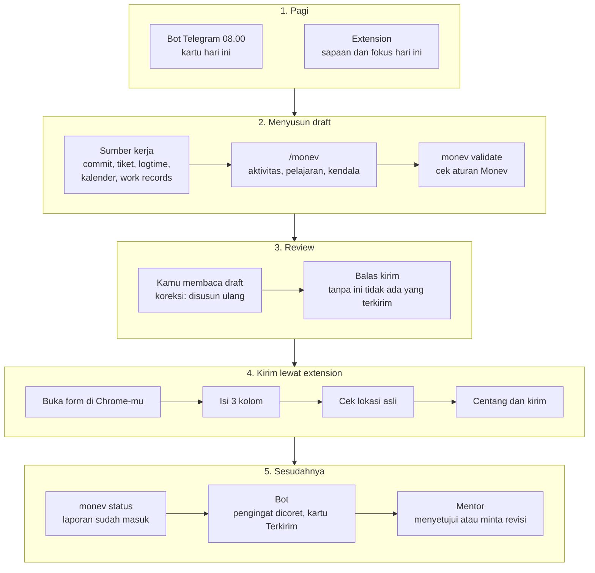
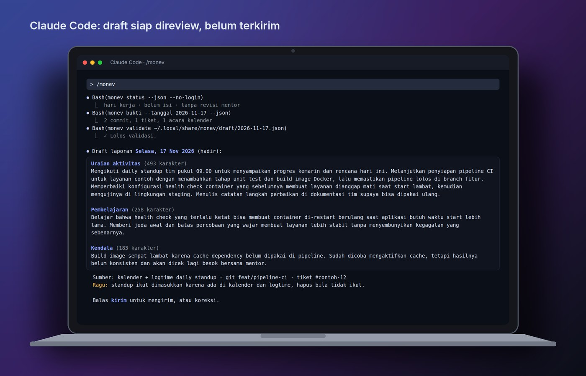
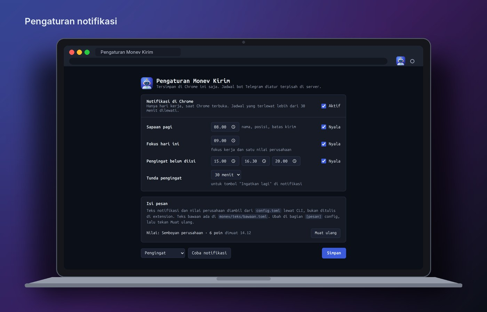

# monev: asisten laporan harian Monev MagangHub


Membantu mengecek, menulis, dan mengirim laporan harian di
[Monev MagangHub](https://monev.maganghub.kemnaker.go.id) dengan **review sebelum kirim** dan **lokasi asli**,
plus pengingat dan rekap kehadiran lewat Telegram.

Email dan password Monev tidak disimpan, login selalu kamu ketik sendiri. Sesi login hanya ada di profil Chrome.

## Alurnya



Laporan tidak pernah terkirim tanpa balasan `kirim` darimu. Bot dan popup hanya membaca Monev.

## Bagian-bagiannya

| Bagian | Fungsi | Wajib? |
|---|---|---|
| CLI `monev` | status, rekap, tulis dan validasi draft, kirim | ya |
| Extension Chrome | mengisi form Monev di Chrome-mu atas perintah CLI, supaya lokasi yang terkirim asli | ya, untuk kirim |
| Skill `/monev` (Claude Code atau Hermes) | menyusun draft dari tanya-jawab, commit/PR GitHub-GitLab, MCP kantor (logtime, tiket, kalender), atau folder work records ([pilih jalur](docs/panduan/pasang.md#sumber-bahan-pilih-jalur)) | tidak |
| Bot Telegram `monev bot` | pengingat jam kerja, notifikasi revisi/ditolak, rekap mingguan dan bulanan | tidak |

### CLI dan Claude Code

Draft disusun dari sumber kerjamu, divalidasi terhadap aturan Monev, lalu ditampilkan utuh untuk direview.
Tidak ada yang terkirim sebelum kamu membalas `kirim`. Panduan: [docs/panduan/pemakaian.md](docs/panduan/pemakaian.md).

| Review draft di Claude Code | Perintah CLI |
|---|---|
|  |  |

### Extension Chrome

Popup menampilkan status hari ini, progres saat CLI meminta kirim, dan kesehatan sambungan. Jadwal notifikasi
diatur di halaman Pengaturan. Panduan: [docs/panduan/pemakaian.md](docs/panduan/pemakaian.md).

| Belum diisi | Sedang mengirim |
|---|---|
|  |  |
| **Terkirim** | **Pengaturan** |
|  |  |

### Bot Telegram

Satu kartu pagi yang diperbarui sepanjang hari, pengingat bertombol, dan `/menu` yang isinya berganti di tempat.
Saat membaca Monev, pesannya menampilkan ⏳ dulu. Panduan: [docs/panduan/bot-telegram.md](docs/panduan/bot-telegram.md).

Semua nama dan data di gambar adalah contoh.

## Mulai cepat

Mau menyimpan salinan sendiri? Klik **Use this template** di GitHub, lalu clone repo milikmu.

```bash
git clone https://github.com/surya-devss/monev.git
uv tool install -e ./monev
monev                        # login sekali di jendela Chrome yang terbuka
monev extension install      # lalu Load unpacked folder extension/ di chrome://extensions
monev kirim --ping           # cek semuanya tersambung
```

Pakai Claude Code atau Hermes? Setelah CLI terpasang, `/monev setup` memandu sisanya: login, extension, dan
menyambungkan sumber bahan (GitHub/GitLab, MCP kantor, work records).

Langkah lengkap ada di [docs/panduan/pasang.md](docs/panduan/pasang.md).

## Dokumentasi

| Mau… | Baca |
|---|---|
| memasang | [docs/panduan/pasang.md](docs/panduan/pasang.md) |
| mengisi laporan setiap hari | [docs/panduan/pemakaian.md](docs/panduan/pemakaian.md) |
| memasang bot Telegram | [docs/panduan/bot-telegram.md](docs/panduan/bot-telegram.md) |
| memahami cara kerjanya | [docs/teknis/arsitektur.md](docs/teknis/arsitektur.md) |
| melihat semua dokumen | [docs/README.md](docs/README.md) |
| ikut mengembangkan | [CONTRIBUTING.md](CONTRIBUTING.md) |

Riwayat perubahan: [CHANGELOG.md](CHANGELOG.md).

## Struktur repo

```
monev/
├── monev/               kode Python: cli/ (perintah), portal/, laporan/, kirim/, bot/, agen/, sumber/, teks/
│                        (lihat docs/teknis/arsitektur.md#struktur-kode)
├── extension/           extension Chrome
├── plugin/              skill /monev untuk Claude Code (juga dipasang ke Hermes)
├── deploy/              Dockerfile dan docker-compose untuk bot
├── scripts/             alat pemelihara repo (cek-bocor.sh)
├── tests/               unit test
├── docs/                panduan/ (pemakai), teknis/ (cara kerja)
├── config.example.toml  contoh config (dibuat otomatis oleh `monev`, tanpa rahasia)
└── .env.example         contoh kunci bot Telegram
```

Satu CLI, tiga cara pakai: terminal (`monev …`), Claude Code (plugin `/monev`), dan Hermes (`monev hermes install`).
Ketiganya menjalankan perintah CLI yang sama.

## Tes

```bash
.venv/bin/python -m unittest discover -s tests
```

## Tanggung jawab

monev adalah proyek independen dan tidak berafiliasi dengan Kemnaker atau MagangHub.
Tool ini membantu mengecek dan mengisi laporan di akun pribadi masing-masing. Isi laporan tetap tanggung jawab
peserta dan harus sesuai pekerjaan nyata.

## Lisensi

[MIT](LICENSE)
