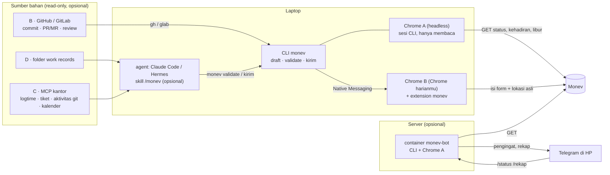
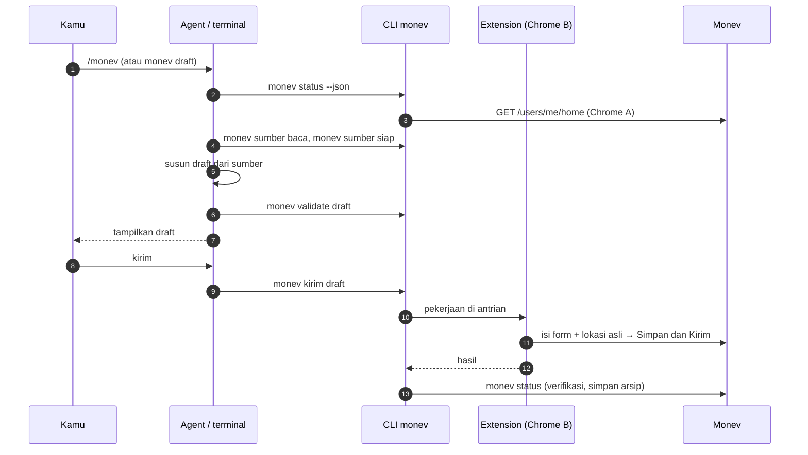

# Arsitektur

Tujuan: laporan harian Monev tidak pernah terlewat, isinya jujur dan jelas bagi mentor, dan **selalu dibaca
ulang oleh pemiliknya sebelum dikirim**.

## Isi halaman

1. [Gambaran](#gambaran)
2. [Dua Chrome, dua sesi](#dua-chrome-dua-sesi)
3. [Alur laporan harian](#alur-laporan-harian)
4. [Kirim lewat extension](#kirim-lewat-extension)
5. [Bot Telegram](#bot-telegram)
6. [Sumber bahan draft](#sumber-bahan-draft)
7. [Struktur kode](#struktur-kode)
8. [Batas keamanan](#batas-keamanan)

## Gambaran



| Bagian | Tugas | Wajib? |
|---|---|---|
| CLI `monev` | satu-satunya pintu: status, rekap, draft, validasi, kirim, bot | ya |
| Extension Chrome | mengisi form di Chrome harian, mengecek lokasi, mengirim | ya, untuk kirim |
| Skill `/monev` | menyusun draft dari sumber yang ada, lalu memanggil CLI | tidak |
| Bot Telegram | pengingat dan rekap, tanpa AI | tidak |

Agent apa pun (Claude Code, Hermes) atau terminal biasa memakai CLI yang sama, dan laporan hanya dikirim lewat
extension. Langkah isi form: [situs-monev.md](situs-monev.md#langkah-mengisi-form).

## Dua Chrome, dua sesi

Monev tidak punya API publik. Access token disimpan di `sessionStorage` dan terikat ke browser (klaim
`fingerprint`), refresh token ada di cookie ±30 hari ([situs-monev.md](situs-monev.md#login--sesi)). Karena itu
semua akses dijalankan **dari dalam halaman Monev di Chrome**, dan setiap profil Chrome punya login sendiri.

| | Chrome A: milik CLI | Chrome B: Chrome harianmu |
|---|---|---|
| Profil | `~/.local/share/monev/chrome-profile/` (di server: volume `monev_data`) | profil Chrome biasa |
| Dijalankan oleh | `monev` lewat Playwright (`channel="chrome"`) | kamu; diisi oleh extension |
| Login | sekali lewat `monev login` (jendela muncul) | sekali di tab Monev biasa |
| Setelah login | headless, tanpa jendela | tab biasa |
| Membaca | `/users/me`, `/users/me/home`, `/attendances`, `/daily-logs`, `/holidays` | status hari ini (sebelum dan sesudah kirim) |
| Menulis | tidak pernah | form "Simpan dan Kirim" |
| Lokasi | tidak dapat | asli, izin sekali per profil |
| Dipakai untuk | status, rekap, doctor, config, bot | kirim laporan |

Dua sesi ini tidak saling memengaruhi. Kenapa tidak satu Chrome: Chrome A bisa jalan di server tanpa layar tapi
tidak mendapat lokasi; Chrome B punya lokasi tapi butuh Chrome-mu terbuka.

## Alur laporan harian



| Langkah | Perintah | Berhenti bila |
|---|---|---|
| 1. status | `monev status --json` | libur, sudah isi, atau ada revisi (ditawarkan alur revisi) |
| 2. bahan | sumber yang tersedia ([lihat bawah](#sumber-bahan-draft)), lalu `monev sumber siap` | `kosong`: lanjut lewat tanya-jawab, tidak mengarang |
| 3. draft | `<draft_dir>/<tanggal>.json` lalu `monev validate` (aturan Monev + saringan nama) | ada ✗ (diperbaiki dulu) |
| 4. review | pemilik membaca draft | ada koreksi (kembali ke 3) |
| 5. kirim | hanya setelah pemilik membalas `kirim` | |
| 6. verifikasi | `monev status` → sudah isi, panjang sama dengan draft, arsip tersimpan | hasil tidak pasti: cek Riwayat, **jangan kirim ulang** |

Instruksi lengkap untuk agent: [`plugin/skills/monev/SKILL.md`](../../plugin/skills/monev/SKILL.md).

### Pengaman draft

Pembagiannya: Python menghitung dan memeriksa, agent menulis dan menimbang.

| Pengaman | File | Cara kerja |
|---|---|---|
| Kesiapan bahan | `monev/sumber/kesiapan.py` | `siap`, `tipis`, atau `kosong` dari jumlah aktivitas dan logtime; repo work records hanya dibaca |
| Saringan nama | `monev/laporan/nama.py` | nama proyek dan klien dikumpulkan dari work records dan `nama_sumber` di draft, lalu ditolak bila tertulis; istilah umum ada di `[nama]` pada `aturan.toml` |
| Proyek pribadi | `[laporan] lewati_proyek` | dilewati saat membaca bahan dan ditolak bila dipakai sebagai tag laporan |
| Carry-over | `monev/sumber/catatan.py` | baris `Daily time log` bertanda `carry-over dari …` bukan kerja hari itu |
| Kerja di luar jam | `monev/sumber/catatan.py`, `monev/laporan/nilai.py` | kerja sejak laporan terakhir yang belum tertulis di arsip masuk laporan berikutnya dengan waktu yang jujur |
| Skor kualitas | `monev/laporan/nilai.py` | `monev eval` membandingkan draft latihan dengan arsip; skor dari kegiatan (70%) dan pembelajaran (30%), kendala hanya ditampilkan |

### Draft terjadwal

```
timer systemd milik user (Persistent=true)
  → monev jadwal jalan: kunci proses, baca status, bersihkan draft lama, cek bahan
  → claude -p + skill /monev otomatis: izin baca saja, hanya bisa menulis ke folder kerja sementara
  → Python memvalidasi ulang, memaksa approved: false, lalu menyimpan <draft_dir>/<tanggal>.json
  → pesan singkat ke Telegram, tanpa isi laporan
```

Komunikasinya satu arah dari laptop ke Telegram. Bot di server dan extension tidak berubah. `monev kirim` tidak ada di
daftar izin proses ini, dan tool MCP harus ditulis lengkap di `[jadwal] alat_mcp`.

## Kirim lewat extension

Extension tidak bisa dipanggil langsung dari terminal, jadi CLI dan extension bertemu lewat folder antrian dan
Chrome Native Messaging.

```
monev kirim draft.json
  │  tulis antrian-<id>.json            (~/.local/share/monev/kirim/, izin 700)
  ▼
extension (tiap 30 detik, chrome.alarms)
  │  panggil monev-native-host  ──►  host menyerahkan pekerjaan, berkas jadi diambil-<id>.json
  ▼
extension membuka/memakai tab Monev → isi form → cek lokasi → centang → Simpan dan Kirim
  │  kirim hasil ke host  ──►  hasil-<id>.json
  ▼
monev kirim membaca hasil → monev status untuk verifikasi
```

- Antrian hanya berisi draft yang sudah disetujui (`approved: true`) dan tidak berisi token.
- Pekerjaan lebih tua dari 10 menit tidak diambil.
- Tiga jenis draft: hadir (form hari ini + lokasi), izin (pilih "Tidak Hadir Dengan Keterangan", tanpa lokasi),
  perbaikan dari mentor (`/dashboard/riwayat?action=revision&date=<tgl>`, panel "Perbaiki laporan").
- `monev kirim --uji` berhenti sebelum centang dan kirim. Persetujuan hanya di chat/terminal.
- Progres: `isi-form.js` menulis langkahnya ke `data-monev-langkah` di DOM tab Monev; service worker membacanya tiap
  detik dan menyimpannya di `chrome.storage.session` (`berjalan`), popup menggambar ulang saat storage berubah.
- Status hari ini: `monevRingkas` (bentuk sama dengan `collect_status`, tanpa koordinat) disimpan di
  `chrome.storage.local` (`ringkas`); popup menampilkan simpanan dulu lalu memperbarui dengan batas waktu.
- Pengingat: `chrome.alarms` harian sesuai halaman Pengaturan (`options.html`) → baca ringkasan dari tab Monev (dibuka
  di latar belakang bila belum ada, lalu ditutup) → `chrome.notifications` dengan ID tetap per jenis (menggantikan,
  tidak menumpuk) bila hari kerja dan belum diisi.
- Teks notifikasi: host menjawab `{"type": "pesan"}` dengan `monev/teks/bawaan.toml` yang ditimpa `[pesan]` di
  config, plus `[profil.nilai]`; extension menyimpannya 6 jam dan tidak punya salinan teks sendiri.
- Host hanya menerima panggilan dari extension dengan ID tetap `fdhbflndlipoblicgdjjkmfilocnngha` (dari `key` di
  `extension/manifest.json`).

## Bot Telegram

Satu proses (`monev bot`) per orang. Polling Telegram (long polling, tanpa webhook, tanpa port terbuka) dan jadwal
harian berjalan di loop yang sama. Setiap pengecekan membuka Chrome A headless, membaca Monev, lalu menutup Chrome
lagi, jadi memori hanya terpakai saat mengecek (puncak terukur ±300 MB).

Chat dibuat tetap pendek: kartu hari ini, pengingat yang sudah selesai, pesan gangguan, dan menu diperbarui di tempat
(id pesannya disimpan di state per hari). Hasil baca Monev disimpan 10 menit di memori untuk status dan rekap yang
ditekan lagi; jadwal, **↻ Segarkan**, dan "Sudah kirim, cek" selalu membaca ulang.

| Bagian | File | Tugas |
|---|---|---|
| Klien Telegram | `monev/bot/telegram.py` | kirim dan edit pesan, rich message, `getUpdates`, menu perintah, membaca token dari env/.env |
| Teks kalimat | `monev/teks/bawaan.toml` | teks bawaan bot dan notifikasi extension, bisa ditimpa `[pesan]` di config |
| Susunan pesan | `monev/bot/pesan.py` | merangkai teks, data, dan tombol ([contoh](format-pesan-telegram.md)) |
| Jadwal | `monev/bot/jadwal.py` | jam dari `[bot]` di config (WIB), kapan pesan dikirim, state anti-dobel (`<data_dir>/bot-state.json`) |
| Proses | `monev/bot/app.py` | loop polling + jadwal, perintah dan tombol, pembaruan pesan di tempat, simpanan hasil baca |

Di server, bot berjalan sebagai container `monev-bot` (image dari `deploy/Dockerfile`: Python + Google Chrome, user
non-root). Sesi Chrome A, config, dan state ada di volume `monev_data`. Deploy dan pemulihan sesi:
[panduan bot](../panduan/bot-telegram.md).

## Sumber bahan draft

Semua dibaca saja (read-only). Detail cara mengambil: [`plugin/skills/monev/references/sources.md`](../../plugin/skills/monev/references/sources.md).

| Jalur | Sumber | Tersedia bila (`monev config --json`) | Dibaca lewat | Kegunaan |
|---|---|---|---|---|
| A | Tanya-jawab | selalu | agent / `monev draft` | melengkapi yang kurang |
| B | Git: commit, PR/MR, review | `git_penyedia` terisi, `gh`/`glab` login | `monev bukti` | bukti hasil |
| C | MCP kantor: logtime, tiket, aktivitas git, kalender | `mcp_awalan_tool` terisi dan tool-nya ada di sesi agent | agent | kerangka aktivitas, judul pekerjaan, **kandidat** acara |
| D | Work records | `workrecords_ada: true` (folder ditemukan `monev sumber cari`) | `monev sumber baca` | aktivitas, pembelajaran, kendala, carry-over, kerja di luar jam |

Status semua jalur: `monev doctor --tanpa-sesi [--json]`. monev tidak tahu nama alat penghasil bahan; titik temunya hanya kontrak format dan config lokal:
[`kontrak-sumber.md`](kontrak-sumber.md).

## Struktur kode

```
monev/
├── cli/                perintah `monev …`; hanya merangkai paket di bawah
│   ├── __init__.py       parser argparse + `main()` (entry point `monev`)
│   ├── _umum.py          kode keluar, tanya-jawab terminal, config otomatis, buka sesi Chrome A / login
│   ├── akun.py           init, config, login, logout, doctor
│   ├── laporan.py        status, rekap, draft, validate, eval
│   ├── kirim.py          kirim, extension
│   ├── bot.py            bot
│   ├── agen.py           hermes
│   ├── jadwal.py         jadwal pasang, status, lepas, jalan
│   └── sumber.py         sumber cari, sumber baca, sumber siap, bukti
├── config.py           lokasi config/data, baca & tulis config.toml, state login
├── teks/               teks bot dan notifikasi extension
│   └── bawaan.toml       teks bawaan; ditimpa sebagian oleh `[pesan]` di config
├── sumber/             sumber bahan yang bisa dibaca CLI (read-only)
│   ├── catatan.py        temukan & ringkas folder work records dari isinya
│   ├── git.py            aktivitas Git milik user lewat gh/glab, dibersihkan
│   ├── jalur.py          status jalur A–D untuk doctor dan /monev setup
│   └── kesiapan.py       cek kesiapan bahan satu tanggal dan kondisi repo work records
├── agen/               pemasang skill ke agent
│   └── hermes.py         pasang/lepas skill /monev di Hermes
├── portal/             akses situs Monev lewat Chrome A (read-only)
│   ├── browser.py        buka Chrome, login, cek sesi, tanggal habis refresh token
│   ├── api.py            GET dari dalam halaman Monev, status hari ini, arsip laporan terkirim
│   └── rekap.py          hitung hadir/izin/absen/peringatan (murni, dites) + ambil datanya
├── laporan/            isi laporan
│   ├── draft.py          template, baca draft .json/.md, hitung panjang seperti JavaScript
│   ├── validasi.py       cek draft terhadap aturan + kemiripan dengan arsip
│   ├── nama.py           saringan nama proyek dan klien yang dikumpulkan dari sumber
│   ├── nilai.py          skor draft terhadap laporan terkirim untuk `monev eval`
│   └── aturan.toml       batas panjang, pola terlarang & peringatan, istilah umum, ambang kemiripan
├── kirim/              CLI ↔ extension
│   ├── antrian.py        berkas pekerjaan dan hasil
│   └── host.py           monev-native-host, pemasangan manifest, diagnosa extension
├── otomasi/            draft terjadwal di laptop
│   ├── jadwal.py         unit dan timer systemd milik user
│   ├── susun.py          keputusan proses, batas izin agent, kunci proses, catatan pesan
│   └── rapi.py           hapus draft yang sudah terkirim atau kedaluwarsa
└── bot/                bot Telegram (lihat tabel di bagian Bot Telegram)

extension/              Chrome MV3: background.js (pekerjaan, pengingat), isi-form.js (isi form), popup, options (Pengaturan)
plugin/                 plugin Claude Code: skills/monev (/monev), skills/status (/monev:status)
deploy/                 Dockerfile, docker-compose.yml
scripts/                alat pemelihara repo (cek-bocor.sh), tidak dipasang ke pemakai
tests/                  unit test: test_config, test_sumber, test_laporan, test_nilai, test_rekap, test_kirim, test_otomasi, test_bot, test_hermes, test_teks, test_dokumen
config.example.toml     isi config bawaan (sama dengan yang dibuat `monev`, dicek tes)
.env.example            kunci bot Telegram (kosong)
```

Aturan ketergantungan: `cli/` boleh memakai semua paket; `bot/` memakai `portal/` dan `teks/`; `kirim/` memakai
`teks/`; `otomasi/` hanya memakai pustaka bawaan Python; `portal/`, `laporan/`, `kirim/`, `agen/`, dan `sumber/` tidak saling memakai (hanya `config.py`;
`sumber/git.py` memakai pola terlarang dari `laporan/aturan.toml` lewat argumen). Paket baru di `monev/` ikut terpasang otomatis
(`pyproject.toml` mencari `monev*`), termasuk di image bot.

## Batas keamanan

- Password selalu diketik pemilik sendiri; tidak pernah lewat tool, Telegram, atau file.
- Tidak ada token/cookie Monev di file selain profil Chrome (izin 700). Profil sesi tidak pernah lewat GitHub.
- Token bot Telegram hanya di `.env` (gitignored) atau secret CI; tidak pernah dicetak.
- Kirim hanya untuk draft yang disetujui pemilik; tidak pernah memilih "Tidak Hadir Tanpa Keterangan".
- Lokasi selalu asli dari Chrome pemilik; koordinat tidak pernah dibuat.
- Isi laporan dicek terhadap data terlarang (IP, URL, nomor tiket, path, email, token, nama di `jangan_disebut`) dan
  nama proyek atau klien yang dikumpulkan dari sumber.
